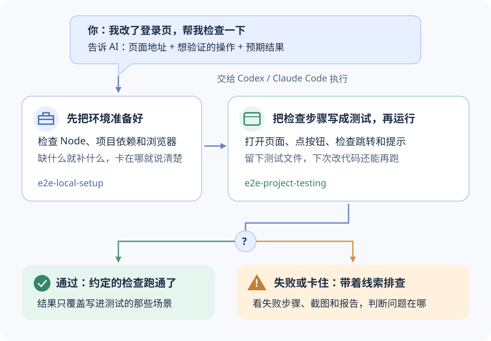

# 🧪🐾 E2E Skills · 让 AI 帮你测网页

改完登录页，又要打开浏览器，把跳转、按钮、表单提示挨个点一遍？这两个技能帮你把检查步骤写成测试，再交给浏览器执行。下次改代码，把同一组测试再跑一遍，少做一些重复点击 ☕

适用于 **Codex 和 Claude Code**，围绕 [e2e-inc/e2e](https://github.com/e2e-inc/e2e) 完成 Web 测试。这个独立仓库只维护两个技能：

| 搭档 | 负责什么 | 什么时候找它 |
|---|---|---|
| 🧰 `e2e-local-setup` | 检查 Node、依赖、浏览器，准备运行环境 | 第一次配置，或测试环境出了问题 |
| 🕹️ `e2e-project-testing` | 写测试、执行检查、分析失败记录 | 改完页面，想检查关键流程有没有坏 |

## 💡 能帮开发者干什么？

| 你遇到的事 | 它能帮什么 | 最后拿到什么 |
|---|---|---|
| 改了登录页，担心跳转和校验坏了 | 把打开页面、点击、检查提示写成测试并运行 | 通过/失败结果，以及可再次运行的测试文件 |
| 每次改代码都要手点相同流程 | 重跑已经写好的检查 | 减少重复操作，检查旧功能有没有受影响 |
| 想加测试，却先卡在环境安装 | 检查 Node、依赖、Chromium | 能运行测试的环境，或具体卡点说明 |
| 测试报错了，不知道哪一步有问题 | 结合操作步骤、截图和日志排查 | 失败线索，以及需要继续验证的方向 |

E2E 可以理解为“像用户一样操作网页，再检查结果”。smoke 测试就是先挑少量关键步骤跑一遍，看看页面有没有明显坏掉。测试通过，只能说明写进测试的那些场景跑通了 🎯

## 🗺️ 一张图看懂怎么配合



你负责说清楚：**页面地址、想检查的操作、预期结果**。两位搭档把这些要求落实为测试；涉及真实登录、下单等业务，还需要可用的服务、测试账号和数据。

## 📦 安装：一条命令，装给两个客户端

先进入**要测试的 Web 项目根目录**，准备 Node、npm 和 Git。安装器要求 Node ≥22.20；下面的测试框架基线要求 Node `^22.22.3 || >=24.8.0`。

```bash
npx --yes skills@1.8.1 add u7-u7/e2e-skills --skill e2e-local-setup e2e-project-testing --agent codex claude-code --yes
```

这条命令适用于 macOS/Linux 终端和 Windows PowerShell。它使用 npm 上的 [Skills CLI](https://github.com/vercel-labs/skills)，从本仓库安装两个技能，不需要手动克隆。技能装好后，再准备测试框架和浏览器。

| 你怎么用 | 命令怎么改 |
|---|---|
| 只装到 Codex | 将 agent 列表改为 `--agent codex` |
| 只装到 Claude Code | 改为 `--agent claude-code` |
| 想在所有项目使用 | 在安装命令末尾加 `--global` |
| 链接受限制，改为复制文件 | 在安装命令末尾加 `--copy` |

如果你习惯先安装命令行工具，也可以用这一组命令，和上面的方式择一：

```bash
npm install --global skills@1.8.1
skills add u7-u7/e2e-skills --skill e2e-local-setup e2e-project-testing --agent codex claude-code --yes
```

第一条把**安装器**装到电脑上；第二条默认把**技能**装到当前项目。需要用户级技能时，第二条也要加 `--global`。

> 🔄 以前从 `u7-u7/dev-skills` 装过？先保留你对同名技能的修改，再执行本仓库的安装命令，切换安装来源。直接运行 `skills update` 会沿用原来记录的来源，不会自动迁移到本仓库。不要用多套安装方式重复管理同名技能。

### ✅ 看看有没有装好

```bash
npx --yes skills@1.8.1 list --agent codex claude-code
```

预期看到两个技能，来源是 `u7-u7/e2e-skills`。用户级安装时，检查命令也加 `--global`。项目级安装会出现 `.agents/skills/`、Claude Code 对应的链接和 `skills-lock.json`。之后重新打开客户端，在这个项目里使用。

## 🪄 装好后，跟 AI 说什么？

第一次使用，先检查环境，再提出具体的测试目标。下面两句话分两次发送即可。

### Codex

```text
$e2e-local-setup 帮我看看这个项目能不能跑网页测试。缺哪些依赖、浏览器有没有装好，请帮我处理；处理不了就告诉我卡在哪。
```

```text
$e2e-project-testing 我刚改了登录页。帮我检查首页能打开、未登录会跳到登录页、账号没填时有提示。把这些检查写成测试并运行，再告诉我结果。
```

### Claude Code

```text
/e2e-local-setup 帮我检查并准备这个项目的网页测试环境。
```

```text
/e2e-project-testing 帮我检查首页、登录跳转和表单提示。写好测试后跑一遍，告诉我哪些通过、哪些失败，以及失败时该看哪里。
```

也可以直接说“帮我给这个项目补网页测试”。补充这三件事，AI 更容易理解你的目标：

```text
页面地址：http://localhost:5173
要检查：打开首页；未登录访问个人中心会跳到登录页；登录表单没填账号时会提示。
当前情况：后端还没启动。先测不依赖后端的部分，需要后端的请告诉我还测不了。
```

你应该拿到可重跑的测试文件、本次结果，以及失败或暂时测不了的具体原因。以后再改相关代码，可以直接说：“把上次那组测试再跑一遍，看看这些流程有没有被改坏。” 🐾

## 🛠️ 想自己敲命令？看这里

以下是 **npm + Vite 项目、项目级技能安装**的示例。已有 E2E 配置或框架时先复用，不重复初始化。脚本需要 Bash；Windows 使用 Git Bash。没有 Bash 时，可让客户端按技能说明直接写配置、执行本地 CLI，无需 WSL。

### 安装测试框架与浏览器

本仓库的兼容基线是 `e2e@0.23.0` + `@e2e-dev/web@0.15.5`，两个包的版本号不同；Node 要满足 `^22.22.3 || >=24.8.0`。

```bash
npm install --save-dev --save-exact e2e@0.23.0 @e2e-dev/web@0.15.5
npx --no-install @e2e-dev/web install chromium
```

pnpm/yarn/bun 项目使用对应命令，沿用自己的锁文件。使用其他框架版本时，先核对它的 API、Node 要求和浏览器版本。

### 生成缺失的配置

在被测项目根目录运行：

```bash
bash .agents/skills/e2e-project-testing/scripts/scaffold-e2e.sh . http://localhost:5173 node node_modules/vite/bin/vite.js --host 127.0.0.1 --port 5173
```

生成 `e2e.config.ts` 和 `tests/smoke.e2e.ts`，已有文件逐个保留。Next.js 可将启动参数换成 `node node_modules/next/dist/bin/next dev --port 3000`，同时把 URL 改成 `http://localhost:3000`。

服务已经手动启动时，省略 `node` 和后续参数，生成只连接现有 URL 的配置。使用固定端口的 HTTP(S) 基地址，不含账号密码、query 或 fragment；非 loopback 地址需要 HTTPS。`APP_URL` 可覆盖访问地址，但不会改变启动端口。

> 🎯 默认测试只检查网页内容能显示。请按实际页面补充标题、路由、表单提示或业务状态断言，才能验证你关心的行为。

### 跑起来

```bash
bash .agents/skills/e2e-project-testing/scripts/run-e2e.sh .
bash .agents/skills/e2e-project-testing/scripts/run-e2e.sh . tests/smoke.e2e.ts --headed
```

运行器使用项目本地 CLI，转发参数与真实退出码。用户级技能安装时，使用实际安装路径；Yarn PnP 或其他配置文件名，请直接用项目自己的 CLI。

## 🩺 没跑通，先看什么？

| 看到的情况 | 先检查 |
|---|---|
| AI 找不到技能 | 是否装在当前项目，用 `skills list` 检查，再重新打开客户端 |
| Node 版本不对 | `node --version` 和当前依赖的 engines 要求 |
| 浏览器找不到 | 让环境技能检查 Chromium，确认安装和运行的缓存路径一致 |
| 页面打不开 | 服务是否启动、地址和端口是否正确 |
| Windows 出现 spawn 错误 | 用 `node` 直接启动框架 JS 入口，或手动起服务 |
| 后端 500 | 区分服务没准备好与应用缺陷，不能一律忽略 |
| 某一步检查失败 | 查看那一步的截图、操作过程和日志 |

记录通常在 `.e2e`，配置了其他输出位置时以项目为准。运行器不删除整个 `.e2e`；框架仍会管理 `results`，重要的失败报告应在重跑前单独归档。

普通 locator/expect 检查不需要模型 Key。测试里使用 `agent.act` / `agent.assert` 时，需要框架单独配置模型；Codex/Claude Code 的登录不自动提供测试框架的模型凭据。密钥不要写进仓库 🔐

## 🎒 可选：便携环境

系统 Node 已满足要求时无需额外配置。便携环境可包含 `node/`（或 `node/bin/`）、`npm-global/` 和 `browsers/`：

```bash
export E2E_HOME="$HOME/tools/e2e-runtime"
source .agents/skills/e2e-local-setup/scripts/e2e-env.sh
```

脚本仅调整当前 shell 的环境，不自动下载或修改全局配置。跨终端调用需重新激活；浏览器缓存优先保留用户的 `PLAYWRIGHT_BROWSERS_PATH`。运行器设置了 `E2E_HOME` 时会加载同级环境技能，非同级布局可用 `E2E_ENV_FILE` 指向实际脚本。

## 🔄 更新与卸载

项目级安装示例，执行前保留自己的技能定制：

```bash
npx --yes skills@1.8.1 update e2e-local-setup e2e-project-testing --project --yes
npx --yes skills@1.8.1 remove e2e-local-setup e2e-project-testing --yes
```

用户级更新把 `--project` 改为 `--global`；用户级卸载加 `--global`。完整卸载不限定 agent，以清理这两个技能的共享目录和客户端链接。卸载技能不会删除业务项目中的测试文件或框架依赖。

## 🏡 仓库里有什么？

```text
e2e-skills/
├── README.md
├── assets/e2e-workflow.svg
└── skills/
    ├── e2e-local-setup/
    │   ├── SKILL.md
    │   ├── agents/openai.yaml
    │   └── scripts/e2e-env.sh
    └── e2e-project-testing/
        ├── SKILL.md
        ├── agents/openai.yaml
        └── scripts/
            ├── scaffold-e2e.sh
            └── run-e2e.sh
```

也可以克隆本仓库，直接使用 `skills/` 下的脚本；脚本接收被测项目目录，不要求被测项目放在本仓库内。

```bash
git clone https://github.com/u7-u7/e2e-skills.git
```

## 🧾 范围与验证

- 本仓库面向浏览器里的 Web 应用；原生移动端、纯 API 测试使用对应工具。
- 沿用项目已有包管理器和测试框架；用户明确选择 e2e-inc/e2e 后才引入它。
- 基线脚本已在 macOS 检查参数、已有文件保护、退出码与缓存保留；框架配置、doctor 和隔离页面 Chromium smoke 已通过，smoke 为 1 个用例。Windows/Linux 实机及具体业务项目需各自验证。
- 本仓库从个人技能合集拆分，保留两个技能的工作流及脚本；Skills CLI 安装、检查、更新与卸载命令已在临时项目验证。

📚 参考：[e2e 官方仓库](https://github.com/e2e-inc/e2e)、[Skills CLI 安装说明](https://github.com/vercel-labs/skills/blob/main/docs/commands.md)、[Codex 技能](https://developers.openai.com/codex/skills/)、[Claude Code 技能](https://code.claude.com/docs/en/skills)。
